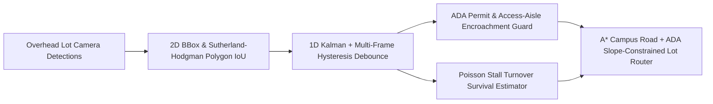

# Park-EZ — Real-Time Computer-Vision Accessible Parking Detection & Campus Lot Routing

[](https://github.com/aazminu/park-ez-vision/actions)
[](https://opensource.org/licenses/MIT)
[](https://abdullahazmi.com)

**Park-EZ** is a computer-vision campus parking lot occupancy geometry engine, ADA van-accessible stall violation monitor, temporal Kalman + hysteresis debounce tracker, and A* accessible campus routing recommender (**1st Place SMU OIT Challenge @ HackSMU VI**).

---

## Core Architecture



### 1. 2D Bounding-Box & Oriented Polygon IoU Geometry (`park_ez.occupancy`)
Supports both axis-aligned bounding boxes and angled ($45^\circ / 60^\circ$) bird's-eye-view (BEV) stall polygons via **Sutherland-Hodgman convex polygon clipping** and the **Shoelace area formula**.

### 2. Temporal Kalman + Multi-Frame Hysteresis Debounce (`park_ez.occupancy`)
Overhead campus cameras suffer from transient occlusions caused by passing pedestrians, shuttle buses, and tree canopy shadows. `TemporalOccupancyTracker` pairs a 1D Kalman occupancy probability filter with an asymmetric multi-frame debounce state machine (`enter_occupied_frames`, `exit_vacant_frames`) to eliminate single-frame flicker.

### 3. ADA Van-Accessible Stall & Access-Aisle Protection (`park_ez.occupancy`)
Monitors both unauthorized occupancy of ADA stalls (`UNAUTHORIZED_NO_ADA_PERMIT`) and physical encroachment into striped wheelchair lift access aisles (`ACCESS_AISLE_ENCROACHMENT`).

### 4. A* Campus Routing & Slope-Constrained Lot Recommender (`park_ez.router`)
Computes shortest travel-time driving paths across campus intersections via A* search and ranks candidate parking structures by combining:
- Driving ETA (`shortest_driving_path_astar`)
- Poisson stall capture probability upon arrival (`estimate_stall_capture_probability`)
- Pedestrian walking distance, curb-cut ramp availability, and pathway running slope compliance ($\le 5.0\%$ per **ADA Standards for Accessible Design §403.3**)

---

## Quick Start

```bash
pip install -e ".[dev]"
pytest -v
```

```python
from park_ez import (
    BoundingBox,
    ParkingStall,
    TemporalOccupancyTracker,
)

stall = ParkingStall(
    stall_id="BINKLEY-ADA-01",
    bbox=BoundingBox(0.0, 0.0, 10.0, 20.0),
    is_ada_accessible=True,
    is_van_accessible=True,
    access_aisle_bbox=BoundingBox(10.0, 0.0, 15.0, 20.0),
)

tracker = TemporalOccupancyTracker(enter_occupied_frames=2)
vehicle = BoundingBox(0.5, 0.5, 9.5, 19.5, confidence=0.96, has_ada_placard_tag=True)
tracker.update_frame([stall], [vehicle])
state = tracker.update_frame([stall], [vehicle])["BINKLEY-ADA-01"]
print(state)
```

---

## Author

**Abdullah Azmi** — Northwestern University (`m4u5t4@u.northwestern.edu`)  
Portfolio: [https://abdullahazmi.com](https://abdullahazmi.com) • GitHub: [@aazminu](https://github.com/aazminu)


## CLI Diagnostics & Invariant Verification

Run the built-in deterministic diagnostic probe and invariant self-check directly via the module CLI:

```bash
PYTHONPATH=src python -m park_ez --self-test --json
```

Run the complete regression test suite:

```bash
PYTHONPATH=src pytest -q
```
